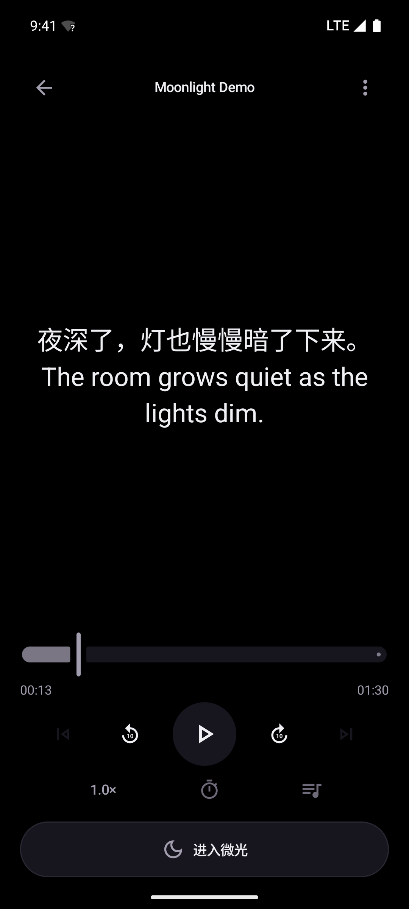

# VortexCue / 荧荧

> **只让文字发光。**

荧荧是一款为睡前聆听而生的 Android 本地音视频播放器。已经躺下，还想继续听一会儿？声音可以继续，OLED 屏幕只留下与播放同步的当前文字。

有字幕就直接读；没有字幕，也可以用自己配置的服务生成同步文字或翻译。荧荧可以从本地视频播放声音，目前不显示视频画面。

[下载 Android 预览 APK](https://github.com/zvensmoluya/VortexCue/releases/download/v0.0.1-preview/VortexCue-0.0.1-debug-4b763d2.apk) · [发布说明](https://github.com/zvensmoluya/VortexCue/releases/tag/v0.0.1-preview)

<p>
  
  
</p>

## 第一次使用

1. 点底栏中央的「添加」，选「打开一个文件」，打开音频或视频。
2. 如果字幕没有自动出现，在播放页打开右上角菜单，选「同步文字 → 主文字 → 从文件添加文字」，选择本地 SRT。
3. 点「进入微光」，按提示校准文字和屏幕亮度。在微光界面长按屏幕，可显示播放控制。

播放本地文件和使用已有字幕不需要配置 API Key。生成同步文字和翻译是可选功能：在「配置」里填写自己的服务和 Key 后，由你主动发起。做语音识别时，音频片段会发给所选服务；做翻译时，字幕文本会发给所选服务，可能产生 API 费用。导入和播放本地文件本身不会上传媒体。

## 获取与构建

当前是 **开发预览**，提供调试签名 APK 供体验。支持 Android 8.0（API 26）及以上。若要从源码构建，需要 JDK 17 和 Android SDK 37。

```powershell
.\gradlew.bat assembleDebug
```

macOS / Linux 使用 `./gradlew assembleDebug`。构建产物在 `app/build/outputs/apk/debug/app-debug.apk`。也可以用 Android Studio 打开项目，直接运行 `app`。

## 开发文档

- [项目为什么这么设计](docs/DOMAIN_CONTEXT.md)
- [当前产品规格和实现边界](docs/GUIDE.md)
- [设计决策、真机验证及品牌探索](docs/README.md)
- [仓库协作约定](AGENTS.md)

## 许可

VortexCue 源代码使用 [Apache License 2.0](LICENSE)。项目名称、商标、Logo、艺术资源、示例媒体和第三方材料不随源代码许可证授权，详见 [NOTICE](NOTICE) 及各自的权利声明。
