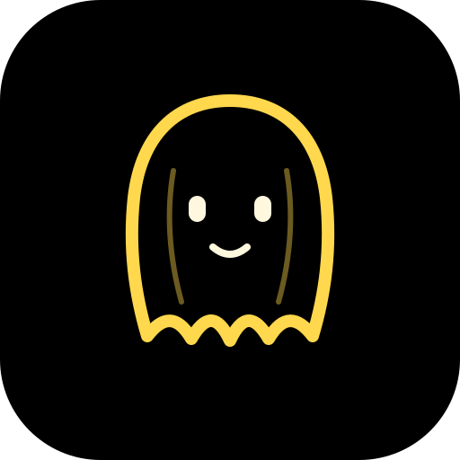
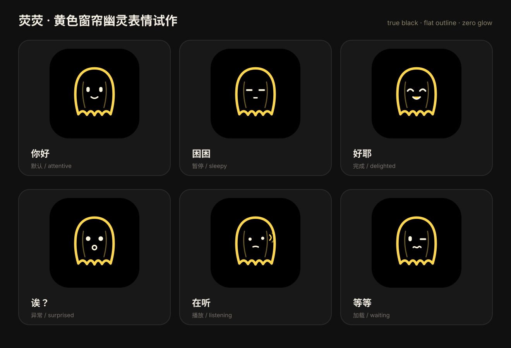

# 黄色窗帘幽灵：品牌探索 001

> 状态：首个未优化探索版
>
> 记录日期：2026-08-07
>
> 适用名称：荧荧 / VortexCue
>
> 用途：保存设计原貌、形成过程与后续判断依据

本记录不是正式发布规范。这里的 SVG 保留第一次形成完整角色语言时的样子，不直接复制到 Android 资源目录，也不代表轮廓、颜色、表情或状态映射已经冻结。

## 预览

默认形象：

首组表情与产品状态设想：

## 阶段结论

黄色窗帘幽灵是本项目第一个不再只像“设计概念”，而开始像真实产品角色的方向。

它保留经典床单幽灵一眼可懂的亲和力，但不依赖白色实体填充、渐变或光晕。纯黑背景上只点亮黄色轮廓、少量窗帘褶皱和暖白表情，既能形成角色，也与荧荧的 OLED 体验保持一致。

这个方向当前最重要的价值不是某一条曲线，而是一套已经成立的角色逻辑：

- 黑暗不是空白，而是角色出现的舞台；
- 角色辨识度主要来自表情和行为，而不是装饰性发光；
- 熟悉的幽灵原型降低理解成本，窗帘轮廓和表情体系负责建立自身性格；
- Logo、吉祥物和产品状态可以从同一个基础轮廓生长出来。

## 创作过程

### 1. 从名称意象出发

最初尝试直接解释 `VortexCue`：漩涡、提示点、时间轨道和字幕线都曾被考虑。这个方向容易解释英文项目名，但图形偏技术标志，缺少“荧荧”需要的陪伴感。

随后转向“微光精灵”或“小幽灵”。早期图像生成探索把微光理解成绿色种子、叶片和火焰，结果更像健康、生态或新能源品牌。这一轮被明确否决，也证明不能把“荧”简单等同于绿色发光物体。

### 2. 从产品行为出发

下一阶段回到产品定义：

> 只让文字发光。

因此尝试过字幕短线、当前 cue 点、时间轨道和大面积黑色负空间。这些图形准确表达了 OLED 微光字幕阅读器，却过于抽象，更像功能图标而不是有情感记忆的消费产品形象。

### 3. 重新引入角色

在抽象字幕方案上进一步尝试了“黑暗本身是身体”的隐身角色，以及带冷色边光、逗号形身体和字幕尾迹的微光幽灵。这些探索确认幽灵可以连接安静、陪伴和夜间使用，但光晕、半透明渐变与荧荧减少发光像素的核心体验存在张力。

### 4. 找到窗帘幽灵

最终的关键判断是：经典白色床单幽灵本身并不是问题，泛化通常来自缺少自身表情和行为。

当前版本因此重新拥抱一眼可懂的床单幽灵轮廓，并作出三项收敛：

1. 使用窗帘般的垂坠侧边、褶皱和波浪底边；
2. OLED 版本不填充白色身体，只保留平面黄色描边与暖白五官；
3. 把设计重点从“幽灵发什么光”转移到“幽灵此刻是什么表情”。

首轮随即扩展出默认、暂停、完成、异常、播放和加载六种表情，验证同一个基础轮廓能够承载产品状态，而不必不断增加新图形。

## 视觉理念

### OLED 真实感

- 背景使用真正的 `#000000`；
- 不使用模糊、滤镜、渐变或光晕；
- 不为表现“微光”而点亮大面积身体；
- 每一个常亮像素都应有轮廓、表情或状态表达上的用途。

产品的微光播放界面仍不应常驻显示 Logo。角色更适合出现在应用图标、引导、空状态、加载、完成和错误反馈中。

### 表情优先

角色的长期辨识度不应只依赖床单外形。表情以点、短线和圆弧为基础笔画，目标是在很小的尺寸中仍能读出情绪，并能自然扩展为贴纸、插画和短暂状态动画。

动画如果加入，应由状态变化触发并很快结束，例如睁眼、眨眼或布料轻落；不做持续漂浮、呼吸或发光循环。

### 熟悉原型，自有性格

经典幽灵能让用户立即理解角色。项目不必为了避免“撞脸”而放弃这一原型，而应通过以下部分逐步建立自身语言：

- 黄色单线轮廓；
- 窗帘般的垂坠和底部褶皱；
- 与播放状态对应的表情体系；
- 荧荧与 `VortexCue` 的双名称字标；
- 克制、短暂、与字幕时间一致的行为。

## 当前视觉参数

| 元素 | 当前值 | 说明 |
| --- | --- | --- |
| 背景 | `#000000` | 真黑，无背景发光 |
| 主轮廓 | `#FFD84D` | 平面亮黄，不附加光晕 |
| 五官 | `#FFF8DF` | 暖白，避免纯冷白的尖锐感 |
| 褶皱 | `#FFD84D`，42% 不透明度 | 大尺寸辅助理解窗帘结构 |
| 基准画布 | `512 × 512` | SVG `viewBox` |
| 主描边 | `14` | 首轮视觉值，尚未形成尺寸规格 |

默认形象 SVG 不包含外部字体、滤镜或渐变。表情板中的文字只用于说明，不属于角色图形。

## 首组表情

| 表情 | 初步状态语义 | 说明 |
| --- | --- | --- |
| 你好 | 默认 | 安静、注意、略带微笑 |
| 困困 | 暂停 | 眼睛和嘴缩成短线 |
| 好耶 | 完成 | 闭眼笑与张口表情 |
| 诶？ | 异常 | 圆眼和圆形嘴表达意外 |
| 在听 | 播放 | 视线偏移并出现两道平面声波 |
| 等等 | 加载 | 单眼眨起，嘴部轻微波动 |

这些映射只是角色能力验证，不是已经批准的产品状态规范。正式接入界面前仍需检查每个场景是否真的值得点亮角色。

## 当前版本刻意保留的问题

作为“首个未优化探索版”，当前文件没有掩盖以下问题：

- 身体偏瘦、偏小，放进桌面图标后仍可适当扩大；
- 轮廓左右过于对称，单看剪影仍接近通用幽灵或水母；
- 底部褶皱较多，尚未收敛为专属节奏；
- 内部褶皱在小尺寸会自然消失，尚未制作响应式简化版本；
- 表情在更小尺寸、不同屏幕密度和实际启动器中尚未系统验证；
- 尚未拆分 Android Adaptive Icon 的前景层、背景层和单色层；
- 尚未设计“荧荧”与 `VortexCue` 的正式字标；
- 尚未进行商标、应用商店和同类图标的正式近似性检索；
- 尚未在不同 OLED 设备和最低亮度下验证黄色与暖白的实际观感。

## 下一轮建议

下一轮不需要增加特效，重点应放在基础轮廓：

1. 将角色整体放大约 10%–15%；
2. 让身体轻微倾斜，一侧垂落、一侧略微掀起；
3. 把底边收敛为三个大小不等的窗帘褶皱；
4. 分别制作完整角色、应用图标和极小尺寸简化版本；
5. 测试 Android 常见圆形、圆角方形和其他自适应图标遮罩；
6. 为“荧荧”主字标和 `VortexCue` 副字标建立组合关系；
7. 只为必要状态设计一次性短动画，并继续遵守发光像素预算。

## 归档文件

- [`curtain-ghost.svg`](curtain-ghost.svg)：默认“你好”形象，保留首轮原始尺寸和线条；
- [`expression-sheet.svg`](expression-sheet.svg)：六种表情及初步产品状态映射。

本地 `output/` 中的中间生成图、渲染图和被否决实验不进入版本控制。若某个后续版本被正式采用，应将可发布资源放入明确的应用资源目录，并另行记录采用决策与验证结果。
