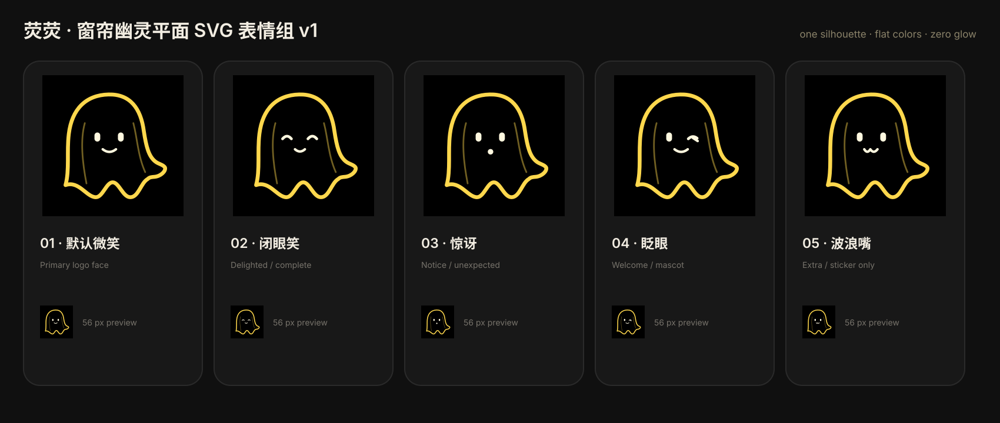

# 掀角窗帘幽灵：品牌探索 002

> 状态：参考重绘与结构校正版
>
> 记录日期：2026-08-07
>
> 适用名称：荧荧 / VortexCue
>
> 用途：保存第二轮轮廓研究、表情体系与返工依据

> 后续状态：探索 003 已将原型 3 号身体锁定为暂定主轮廓。本轮统一身体继续保留为返工依据，但不再是当前主轮廓候选。

本轮不是正式发布规范，也不是对参考位图的自动描摹。它在探索 001 的角色方向上，依据一组外部生成参考进行手工矢量重建，目标是找到更自然、更有动作感，同时仍符合 OLED 约束的统一基础轮廓。

## 预览

默认微笑：

五种表情与 56 px 检查：

## 阶段结论

探索 001 证明了“黄色线描窗帘幽灵”可以成为荧荧的角色。探索 002 进一步找到了更像这个角色自己的动作：身体左侧自然垂落，右侧布角被轻轻掀起，底边则由连续的长曲线形成两道下垂褶皱。

这次最重要的收获不是复刻某张参考图，而是确认三个会直接改变角色气质的结构关系：

- 底边必须像一整块柔软布料连续受力，不能由几段短促、尖锐的波峰拼接；
- 内部褶皱既描述布料重力，也会成为脸部的隐形取景框；
- 表情中心必须和两道褶皱形成的视觉轴一致，否则即使五官本身对称，角色也会显得在侧头看。

默认微笑当前最适合作为主 Logo 候选；其他表情验证同一身体能否稳定发展为吉祥物和产品反馈语言。

## 创作过程

### 1. 从参考图提取真正有效的部分

参考图提供了五种表情，并把探索 001 近乎对称的站姿改成右侧掀角。真正值得保留的是以下关系：

1. 头顶仍然圆润、安静，不把幽灵做成火焰或水滴；
2. 左侧保持垂坠，右侧轮廓先收束再抬起，形成轻微招手般的动作；
3. 底边只有少数几个大褶皱，节奏比探索 001 更明确；
4. 表情只使用暖白基础笔画，性格来自眼睛与嘴的组合，而不是附加装饰。

颜色、轮廓和五官均重新以 SVG 曲线构造。参考位图中的纸张纹理、柔光和颗粒没有进入矢量结果，因为它们会削弱 OLED 主题“只点亮必要像素”的产品逻辑。

### 2. 第一版矢量化：轮廓成立，底边失去布感

第一版已经形成右侧掀角的整体剪影，但底部使用了过短的贝塞尔控制柄。结果是谷底和波峰转折生硬，中央上拱过尖，右侧褶皱接入掀角时还出现了明显折点。

这个问题在完整图上容易被表情分散注意力，裁出底部与参考图并排后才清楚：参考图的褶皱不是连续的小波浪，而是两段由重力拉出的长下垂曲线。

第二次重绘因此不再逐个“画波峰”，而是从左侧落点一路建立连续受力：拉长控制柄、降低并钝化中央上拱，再让右侧下垂自然过渡到掀起的布角。修正后，2–5 号表情下方最有辨识度的流线被统一到全部文件中。

### 3. 第二版校正：褶皱让角色产生了错误视线

底边变柔软后，内部两道褶皱仍不对。最初的褶皱长度和弯曲方向过于接近，而且五官整体落在褶皱中线右侧，造成“脸向左看”或布料扭向一边的错觉。

再次对照上半身后，结构差异变得明确：

- 左褶皱较长，从肩部附近向内收后一直落到接近底边；
- 右褶皱较短，末端顺着受力弯向被掀起的右角；
- 两道褶皱顶部的中点约为 `x = 242`，因此五官中心也应落在 `x ≈ 242–243`。

最终将整套表情向左移动约 13 px，并分别重画两道褶皱。左褶皱落到 `y = 393`，右褶皱止于 `y = 352`；它们不再被理解为两只手臂，也不会把脸挤向一侧。

### 4. 同步成一套表情

完成结构修正后，五个文件共用完全相同的身体路径与褶皱，仅替换五官：

| 编号 | 表情 | 建议角色 | 当前判断 |
| --- | --- | --- | --- |
| 01 | 默认微笑 | 主 Logo / 默认形象 | 最稳定，优先继续打磨 |
| 02 | 闭眼笑 | 完成 / 开心反馈 | 情绪明确，适合短暂出现 |
| 03 | 惊讶 | 提醒 / 意外状态 | 可爱但不应代替严肃错误提示 |
| 04 | 眨眼 | 欢迎 / 吉祥物互动 | 个性较强，适合引导与宣传 |
| 05 | 波浪嘴 | 贴纸 / 额外表情 | 趣味性高，暂不作为产品状态 |

组合检查板同时放置 240 px 与 56 px 预览，用来快速观察缩小后轮廓、褶皱和表情是否仍然可读。板中的文字只是设计说明，不属于 Logo 图形。

## 视觉与结构参数

| 元素 | 当前值 | 说明 |
| --- | --- | --- |
| 基准画布 | `512 × 512` | 五个独立 SVG 共用 `viewBox` |
| 背景 | `#000000` | 真黑 |
| 主轮廓 | `#FFD84D` | 平面亮黄，无光晕 |
| 五官 | `#FFF8DF` | 暖白 |
| 主描边 | `14` | 圆端点、圆连接 |
| 褶皱描边 | `6`，44% 不透明度 | 大尺寸辅助布料结构 |
| 表情描边 | `9–10` | 小尺寸优先可读性 |
| 效果 | 无 | 不含滤镜、渐变、纹理或外部字体 |

基础身体路径和两道褶皱在五个独立文件及组合检查板中保持一致。默认表情双眼中点为 `x = 242`，嘴部中心为 `x = 243`，与褶皱视觉轴基本重合。

## 当前版本刻意保留的问题

- 这是轮廓研究稿，还没有转成 Android Adaptive Icon 的前景、背景和单色资源；
- 56 px 只完成视觉预览，尚未针对 48 px、32 px 或更小尺寸制作响应式简化路径；
- 启动器的圆形、圆角方形等遮罩可能裁掉左下落点或右侧掀角，仍需安全区测试；
- 内部褶皱在较小尺寸可能应完全移除，而不是简单随整体缩放；
- 当前黄色和暖白尚未在不同 OLED 设备、最低亮度和无障碍对比度条件下验证；
- “荧荧”与 `VortexCue` 的字标、横竖组合及中英文层级仍未设计；
- 参考图帮助确定了姿态和表情范围，后续还需继续拉开专属剪影，并进行商标、应用商店及同类角色近似性检索。

## 下一轮建议

1. 围绕当前默认微笑做 2–3 个只调整剪影的微差版本，不再同时改变表情；
2. 在 Android 常见自适应图标遮罩和真实桌面尺寸中检查右侧掀角；
3. 制作小尺寸简化版，比较“保留褶皱”和“仅保留外轮廓”；
4. 试作“荧荧”主字标与 `VortexCue` 英文副标，判断角色应独立使用还是参与字标；
5. 将闭眼、眨眼等表情做成一次性短动画原型，继续避免持续光晕和循环漂浮。

## 归档文件

- [`01-default-smile.svg`](01-default-smile.svg)：默认微笑，当前主 Logo 候选；
- [`02-closed-eye-smile.svg`](02-closed-eye-smile.svg)：闭眼笑；
- [`03-surprised.svg`](03-surprised.svg)：惊讶；
- [`04-wink.svg`](04-wink.svg)：眨眼；
- [`05-wave-mouth-extra.svg`](05-wave-mouth-extra.svg)：额外波浪嘴表情；
- [`curtain-ghost-expression-set.svg`](curtain-ghost-expression-set.svg)：五种表情及 56 px 组合检查板。

原始生成参考、PNG 渲染、局部对比图和被替换的中间曲线继续保留在本地忽略的 `output/` 实验区，不进入版本控制。这样既保存可延续的矢量成果和判断依据，也避免把生成素材与临时渲染误当成正式品牌资产。
