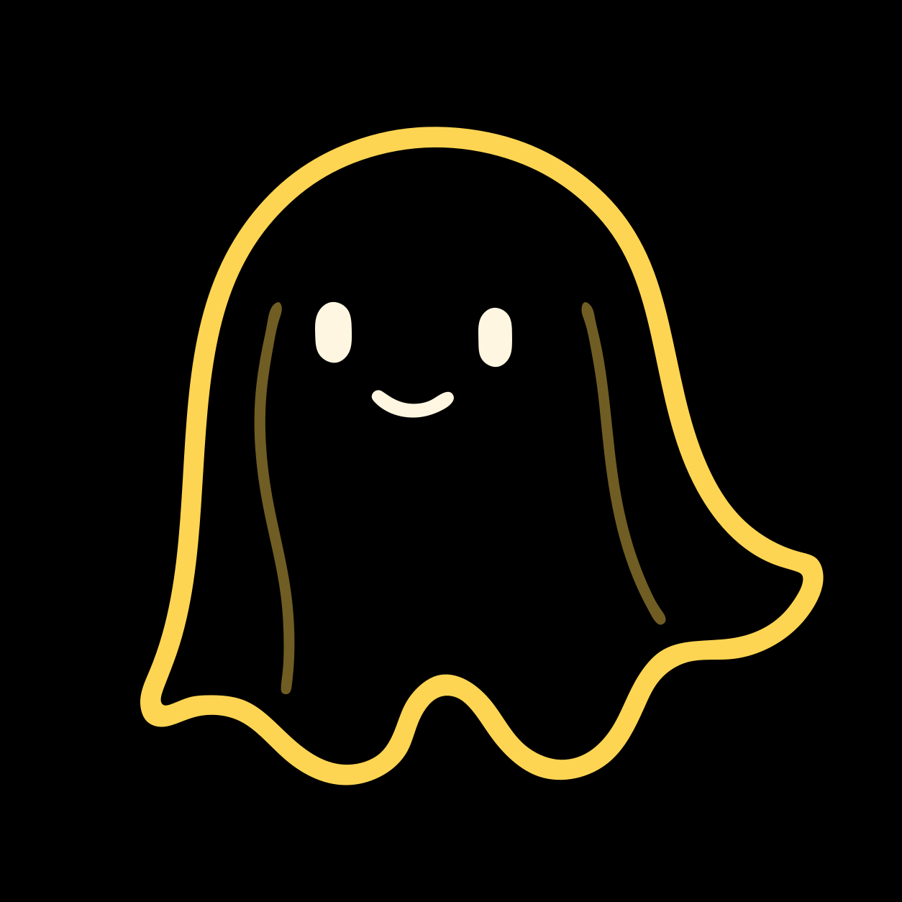

# 原型 3 号身体：品牌探索 003

> 状态：暂定主轮廓已锁定
>
> 记录日期：2026-08-08
>
> 适用名称：荧荧 / VortexCue
>
> 当前默认脸首选：原型 2 号脸，尚未冻结

本轮将原型 3 号身体确认为后续品牌工作的暂定统一身体。这个决定来自同一组五张脸在原型 3 号与 4 号身体上的等条件比较，并同时检查了大图、56 px 和 32 px 表现。

这里的“锁定”针对视觉轮廓，不代表当前自动拟合路径已经达到发布质量。后续可以减少节点、重建贝塞尔曲线和制作小尺寸专用路径，但不应重新改变已经选定的身体比例与动作语言。

## 暂定主标

当前组合使用原型 3 号身体与原型 2 号脸。2 号脸的长圆眼睛和单一微笑弧线在 56 px 与 32 px 中比其他表情更稳定，也意外地与 3 号身体的舒展轮廓形成了良好平衡。

## 统一表情

五套表情现已迁移到完全相同的 3 号身体。下列角色只用于保存当前判断，正式产品状态语义尚未冻结。

| 文件 | 原型脸 | 当前角色判断 |
| --- | --- | --- |
| `01-default-smile.svg` | 2 号脸 | 默认脸首选，优先继续验证小尺寸 |
| `02-closed-eye-smile.svg` | 3 号脸 | 安静、完成或放松状态 |
| `03-surprised.svg` | 4 号脸 | 最有记忆点的意外或提醒反应 |
| `04-wink.svg` | 5 号脸 | 欢迎、引导或短暂互动 |
| `05-wave-mouth-extra.svg` | 1 号脸 | 贴纸和额外趣味表情 |

## 已锁定内容

- 原型 3 号身体的整体高宽比例；
- 左侧自然垂落、右侧掀角伸出的非对称姿态；
- 圆顶、两道底部下垂和中央上拱之间的节奏；
- 两道内部褶皱与外轮廓的相对位置和受力方向；
- 五种表情后续共用同一身体，不再随表情改变轮廓。

## 尚未锁定内容

- 当前路径的节点数量、控制柄和具体曲线拓扑；
- 原型 2 号脸是否最终成为正式默认脸；
- 32 px、48 px 等小尺寸是否需要单独加粗或简化；
- Android Adaptive Icon 的前景安全区、背景层和单色层；
- 黄色与暖白在真机最低亮度下的最终色值；
- “荧荧”与 `VortexCue` 字标及其组合方式。

## 当前判断

原型 3 号身体比 4 号身体拥有更舒展的右侧动作和更明确的专属剪影；4 号身体更圆、更可爱，但在多个表情和小尺寸下更接近通用幽灵。3 号身体因此成为当前统一身体，4 号惊讶脸仍可作为表情体系中最有记忆点的反应状态。

原型 2 号脸暂列默认脸首选，而不是与身体同等级冻结。正式确定前仍需放入启动器遮罩和真实桌面尺寸比较。

## 资源说明

- [`01-default-smile.svg`](01-default-smile.svg)：原型 3 号身体与原型 2 号脸的暂定主标；
- [`02-closed-eye-smile.svg`](02-closed-eye-smile.svg)：闭眼笑；
- [`03-surprised.svg`](03-surprised.svg)：惊讶；
- [`04-wink.svg`](04-wink.svg)：眨眼；
- [`05-wave-mouth-extra.svg`](05-wave-mouth-extra.svg)：波浪嘴额外表情；
- 画布为 `1254 × 1254`，保留像素拟合阶段的坐标；
- 使用真黑背景、平面黄色轮廓、低强度褶皱和暖白五官；
- 不包含位图、字体、滤镜、渐变、纹理或光晕；
- 当前文件用于保存选型和表情迁移结果，不直接复制到 Android 资源目录。

生产路径重建已在 [`004-production-vector/`](../004-production-vector/) 中继续。003 保留为视觉锁定基准，不用优化路径覆盖这里的原始拟合结果。

Android 平台资源现已直接由本目录的默认脸母版派生，适配尺寸、分层与验证记录见 [`platform/android/`](../../platform/android/)。

## 下一步

1. 校正五套表情的共同视觉轴，并复核状态语义；
2. 制作 56 px、48 px 和 32 px 响应式版本；
3. 在允许安装的 Android 真机上确认 Launcher 与 themed icon；
4. 再决定原型 2 号脸是否升级为正式默认脸。
